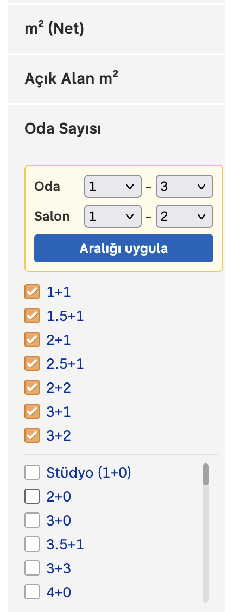

# Sahibinden Aralık Filtresi

sahibinden'de ev ararken **Bina Yaşını**, **Oda Sayısını**, **Kat Sayısını** ve **Bulunduğu Katı** tek tek işaretlemekten sıkıldın mı? O zaman bu extension tam sana göre. Bu extension sayesinde artık bunları tek tek işaretlemek yerine olması gerektiği gibi bir aralık olarak seçebilmeye başlayacaksın bunları.

Evet, evet doğru duydunuz. Artık teker teker bunları seçmek zorunda kalmayacaksınız. Rica ederim arkadaşlar, iyi ev bakmalar.

Bundan sonrasını AI yazdı ve teknik bilgiler ilgiliyseniz okumaya devam edebilirsiniz.

> sahibinden.com ile resmi bir bağlantısı yoktur. Bağımsız, açık kaynak bir projedir.

<!-- Ekran görüntüsü: aralık kutusu açıkken bir arama sayfası -->


## Neden?

Sahibinden'de "5 ile 15 yaş arası, 2+1 veya 3+1, 3. ile 8. kat arası" bir daire aramak için onlarca kutucuğu tek tek işaretlemen gerekiyor. Bu eklenti her filtrenin üstüne iki açılır menü koyar: başlangıç ve bitiş seç, **Aralığı uygula**'ya bas, gerisini eklenti halletsin.

## Özellikler

| Filtre | Nasıl çalışır |
|---|---|
| **Bina Yaşı** | 0, 1, 2 … 5, 6-10, 11-15 … 31+ arasında aralık. Sahibinden yaşları gruplu verdiği için duraklar bu gruplarla aynı. Başlangıç 0 seçilirse *Oturuma Hazır* / *Yapım Aşamasında* ayrı ayrı seçilebilir. |
| **Oda Sayısı** | Oda ve salon için **ayrı** aralık: "Oda 2–3, Salon 1" → 2+1, 2.5+1, 3+1. |
| **Kat Sayısı** | 1 … 29, 30+ arasında aralık. |
| **Bulunduğu Kat** | 0 ve altı, 1 … 29, 30+ arasında aralık. Başlangıç "0 ve altı" seçilirse Kot, Bodrum, Zemin, Bahçe, Giriş, Yüksek Giriş ayrı ayrı seçilebilir; 1 ve üstü seçilirse bunlar dahil edilmez. **Çatı Katı** her zaman ayrı bir kutucukla dahil edilir veya çıkarılır. |

- Satılık ve kiralık tüm konut aramalarında çalışır.
- Fiyat, m², konum gibi diğer filtrelerine dokunmaz.
- Sahibinden'in kendi kutucuk listesi yerinde kalır, istersen elle seçmeye devam edebilirsin.
- Sayfayı açtığında mevcut filtrelerin aralığa dönüştürülüp kutuya doldurulur.
- **Hiçbir veri toplamaz**, hiçbir sunucuya istek atmaz. Sadece sahibinden.com sayfalarında çalışır. Ayrıntılar: [Gizlilik Politikası](PRIVACY.md).

## Kurulum

### Mağazadan

- Chrome Web Store — *yakında*
- Firefox Add-ons — *yakında*

### Kaynaktan (geliştirici modu)

Repoyu indir veya klonla:

```bash
git clone https://github.com/erincayaz/sahibinden-aralik-filtresi.git
```

**Chrome / Edge / Brave**
1. `chrome://extensions` adresini aç.
2. Sağ üstten **Geliştirici modu**nu aç.
3. **Paketlenmemiş öğe yükle** → repo klasörünü seç.

**Firefox**
1. `about:debugging#/runtime/this-firefox` adresini aç.
2. **Geçici Eklenti Yükle** → repo içindeki `manifest.json` dosyasını seç.
3. Kutu görünmezse: araç çubuğundaki Uzantılar menüsünden eklentiye **sahibinden.com'da her zaman izin ver**.

> Firefox geçici eklentileri tarayıcı kapanınca kaldırır.

## Kullanım

1. sahibinden.com'da bir konut araması aç (ör. *Satılık Daire → İstanbul*).
2. Sol paneldeki Bina Yaşı, Oda Sayısı, Kat Sayısı veya Bulunduğu Kat başlığına tıklayıp aç.
3. Listenin üstündeki sarı kutudan başlangıç ve bitişi seç.
4. **Aralığı uygula**'ya bas.

Birden fazla filtrede aralık seçip tek seferde uygulayabilirsin.

## Nasıl çalışır?

Sahibinden çoklu seçimi URL'de aynı parametreyi tekrarlayarak yapıyor:

```
/satilik-daire/istanbul?a812=40604&a812=40603
```

Eklenti sayfadaki seçenekleri okur, etiketlerine göre sıralar, seçtiğin aralığa düşenleri bulur ve bu formatta bir URL'e yönlendirir. Yani arama tamamen sahibinden'in kendi altyapısıyla yapılır.

| Parametre | Filtre |
|---|---|
| `a812` | Bina Yaşı |
| `a20` | Oda Sayısı |
| `a810` | Kat Sayısı |
| `a811` | Bulunduğu Kat |

## Geliştirme

```
manifest.json      Manifest V3 (Chrome + Firefox ortak)
src/core.js        Saf mantık: etiket ayrıştırma, aralık → seçenek, URL kurma (DOM'a dokunmaz)
src/content.js     Sayfaya aralık kutusunu ekleyen content script
src/content.css    Kutu stilleri
icons/             Eklenti ikonları (scripts/make-icons.py ile üretilir)
test/              core.js birim testleri
scripts/           İkon üretimi ve paketleme
store/             Mağaza metinleri ve görselleri
```

Node 18+ ve Python 3 yeterli, bağımlılık yok:

```bash
npm test          # birim testleri
npm run package   # testleri çalıştırır, dist/ altına Chrome ve Firefox zip'lerini üretir
npm run icons     # icons/ altındaki PNG'leri yeniden üretir
```

Chrome paketinde Firefox'a özel `browser_specific_settings` alanı çıkarılır; geri kalanı iki tarayıcıda aynıdır.

## Bilinen sınırlamalar

- Eklenti sahibinden'in sayfa yapısına bağlı. Site değişirse kutu görünmeyebilir. Böyle bir durumda lütfen [issue aç](https://github.com/erincayaz/sahibinden-aralik-filtresi/issues).
- Bina yaşı aralıkları sahibinden'in gruplarına bağlı; örneğin "7–12" seçilemez, "6-10 ile 11-15 arası" seçilir.
- Aralığı uygulamak o filtrenin URL'deki seçimlerini yeniden yazar. Aynı filtrede elle işaretleyip henüz aramadığın kutucuklar kaybolur.

## Katkı

Hata bildirimi ve önerilere açığız. [Issue](https://github.com/erincayaz/sahibinden-aralik-filtresi/issues) açabilir veya pull request gönderebilirsin.

## Lisans

[MIT](LICENSE) © erincayaz

---

### In English

A Chrome & Firefox extension (Manifest V3) for sahibinden.com, Turkey's largest classifieds site. When searching for homes, the site only lets you tick building age, room count, total floors and floor level one checkbox at a time. This extension adds a min–max range picker on top of each of those filters and turns your range into the site's own multi-select URL parameters. No data collection, no network requests, no dependencies. Not affiliated with sahibinden.com.
